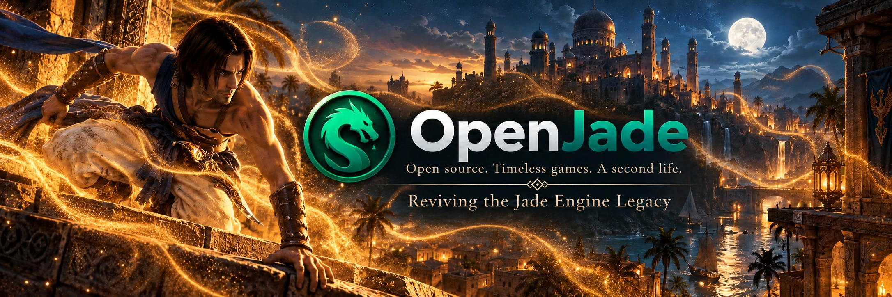

# OpenJade

  

**An open-source reimplementation of Ubisoft's Jade Engine, with the long-term goal of supporting multiple games.**

## About the project

OpenJade is an independent research and reverse-engineering project aimed at recreating the functionality of Ubisoft's Jade Engine from scratch, without access to the original engine source code.

The project currently focuses on Prince of Persia: The Sands of Time (2003) as its initial reference, using the PC GOG edition for research and validation.

However, OpenJade is not intended to remain limited to a single game. Its long-term vision is to develop a reusable engine architecture capable of supporting other Jade Engine titles, including the rest of the Prince of Persia trilogy and Beyond Good & Evil.

The project emphasizes documented reverse engineering, independently implemented systems, and the preservation of classic games through modern, open-source technology.

Native Windows, Linux and macOS support is a long-term objective. Game resources must come from the user's own local installation and are not distributed here.

> [!NOTE]
> Generative AI assists with research and implementation under human supervision.
> Findings and generated code are subject to testing and verification.

## Game compatibility

| Game | Status |
| --- | --- |
| Prince of Persia: The Sands of Time (2003) | Active development |
| Prince of Persia: Warrior Within (2004) | Planned |
| Prince of Persia: The Two Thrones (2005) | Planned |
| Beyond Good & Evil (2003) | Long-term objective |

Each game may require additional research into engine versions, proprietary resources and game-specific systems.

**No game is currently playable through OpenJade.** Planned titles represent development goals, not existing compatibility or guaranteed future support.

## Current status

**An early native menu prototype runs on Windows. The game is not playable.**

The current implementation focuses on reconstructing the main menu and its surrounding 3D environment from Prince of Persia: The Sands of Time.

The Rust/Vulkan viewer combines decoded 3D menu scenery with an interactive main
menu:
- Selecting Start New Game hides the interface and plays a nine-second
Camera02 transition toward the balcony, where the camera stops.
- Transparent scene effects are re-sorted as the camera moves.
- Escape returns to the main menu.

There is no controllable Prince, cutscene playback or level loading.

The scenery includes 48 decoded objects, textures, depth testing, three fog panels
and multi-pass light-fixture materials:
- Supported fog and flame-texture offsets
animate in real time.
- Seven palms now move using their decoded vertex deformation.
- Eight splash emitters animate alongside the two falling-rain emitters. The rain uses decoded parameters and verified particle geometry, colors and blending; timing remains under comparison.
- A measured scene-blur effect softens the 3D background while keeping the menu interface sharp.
- Scene textures retain their decoded dimensions; filtering and generated mipmaps can be compared in the viewer.
- Lighting, transparency ordering and visual fidelity remain under investigation; this is not a faithful recreation yet.
- The sky and moon are now included; some small effects remain absent.
- Named scene lights are not yet reproduced as runtime lights; recorded vertex colors provide
part of the current appearance.

The detailed menu screens now run in the native viewer alongside the 3D scenery:
- Gamma, texture filtering, window resolution and V-Sync can be changed there,
with changes applied only after Back and confirmation, plus OpenJade-owned persistence.
- Profile selection and keyboard-binding editing are available; they do not load
original saves or control a playable character.

Audio/gameplay and unsupported graphics options are visibly disabled.

Python is used for offline preparation and research, not required alongside a prepared native menu.

## Prototype preview

The native prototype displays the main menu and its 3D background in one window,
with mouse/keyboard navigation, profile creation/selection, Controls, Game, Graphics Effects/Advanced, Sound and confirmation screens.

Original credits remain an explicit notice and Load Game is unavailable.

Text and widgets are composed in Rust using locally prepared MFT/DDS resources. The logo and cursor retain their original image dimensions, and text selects among twelve bitmap font variants as the window grows; the interface uses linear filtering.

Captures and generated asset bundles remain local and are not included in the
repository.

See the [native prototype workflow](README-dev.md#native-menu-prototype) and the [separate Python simulation](README-dev.md#menu-simulation).

## Implemented capabilities

| Area | Available today | Main limit |
| --- | --- | --- |
| Archives | Tested BF/BIG extraction and recognized POP-LZO decoding | Not a universal archive decoder |
| Resources | MGM structure/materials, menu links, DDS and MFT previews | Selected layouts; font styling remains experimental |
| Python menu simulation | Retained as a research/reference tool | No gameplay; optional legacy gamma bridge |
| Native menu | Detailed screens over 3D scenery, four confirmed display controls, local profiles/settings and confirmations | Unsupported systems disabled; bindings stored but no gameplay |
| Camera02 | Nine-second transition sampled from decoded tracks and played by the native viewer | Baked 60 Hz poses; no original scripting runtime or gameplay trigger chain |
| Scene materials | Textures, depth, fog, scene blur, partial masked glow and multi-pass fixture blending | Original lighting, remaining particle effects and exact filtering remain unresolved |
| Menu rain | Two animated emitters with native textures and three life phases | Random sequence and scene-wide timing are not synchronized with the original |
| Validation | Synthetic tests, Vulkan validation and local visual checks | Windows/AMD tested; no Linux/macOS validation |

## Development approach

OpenJade combines reverse-engineering research with the gradual development of a native engine.

The project currently relies on two complementary components:

- **Research tools:** Python, PowerShell and supporting utilities for archive extraction, proprietary format analysis, resource preparation and validation.
- **Native engine:** A Rust-based implementation using Vulkan for rendering, progressively reconstructing the behavior of the original engine.

While Prince of Persia: The Sands of Time provides the initial reference, the long-term architectural goal is to distinguish reusable engine functionality from game-specific behavior.

This approach is intended to facilitate future research and compatibility work across different Jade Engine titles.

## Roadmap

Development is organized around progressive milestones rather than fixed release dates.

### Phase 1 - Sands of Time foundation (current)

1. Improve scene fidelity: lighting, fog, filtering and transparency ordering.
2. Connect remaining menu settings to implemented game systems and refine interface fidelity.
3. Extend animation and scene/object systems beyond the baked camera transition.
4. Investigate collision, player control, cutscenes, audio and gameplay incrementally.

### Phase 2 - Core engine development (planned)

1. Expand reusable engine systems beyond the initial menu prototype.
2. Investigate scene management, object behavior and gameplay interactions.
3. Progress toward a functional implementation of Prince of Persia: The Sands of Time.
4. Continue investigating differences between original engine behavior and the independent implementation.

### Phase 3 - Extended game compatibility (long-term)

1. Investigate engine and resource differences across the Prince of Persia trilogy.
2. Explore support for Prince of Persia: Warrior Within and The Two Thrones.
3. Research Beyond Good & Evil and identify its game-specific requirements.
4. Extend the engine architecture where necessary to accommodate additional titles.

Future compatibility priorities may evolve based on research findings, technical feasibility and available contributions.

### Cross-platform support

Development and testing are currently limited to Windows.

Linux and macOS are not supported or validated at this stage. Native support for these platforms remains a long-term objective, to be investigated as the engine matures.

There is no completion date or reliable overall completion percentage.
See [milestones and validation criteria](README-dev.md#roadmap-and-milestones).

## Getting started

Development currently uses Windows. The native viewer requires the Rust/Vulkan build environment and locally generated scene/menu bundles; research tools use PowerShell and Python.

Ghidra supports optional static analysis and is not required to launch a prepared preview.

Start with the [developer setup guide](README-dev.md#getting-started), then choose the [native menu prototype](README-dev.md#native-menu-prototype) or the [Python menu simulation](README-dev.md#menu-simulation).

A fresh checkout contains neither original game resources nor generated bundles.

## Documentation

- [Developer guide](README-dev.md): setup, commands, tests, milestones and architecture.
- [Engine guide](engine/README.md): native viewer build and launch.
- [Format notes](docs/formats): observed layouts and local interchange formats.
- [Research observations](docs/observations): dated evidence and experiments.
- [Project decisions](docs/decisions) and [external research provenance](references).

## Contributing

OpenJade is an independent hobby project, and contributions are welcome.

Contributions may include reverse-engineering research, format documentation, testing, implementation improvements and technical feedback.

Research findings should ideally be reproducible, with verified observations clearly distinguished from assumptions or unresolved hypotheses.

There is no guaranteed completion date or release schedule.

## License & Legal Disclaimer

OpenJade is an independent research and open-source reverse-engineering project. It is not affiliated with, endorsed by, associated, or sponsored with Ubisoft.

All trademarks and product names belong to their respective owners. Prince of Persia, Beyond Good & Evil, the Jade Engine, and all associated trademarks and game assets remain the property of their respective rights holders.

No original game data, copyrighted assets or proprietary engine source code are distributed with this repository. Users must provide resources from their own legally obtained game installations.

OpenJade is licensed under the GNU General Public License v3.0 or later
(GPL-3.0-or-later). See [LICENSE](LICENSE) for details.
