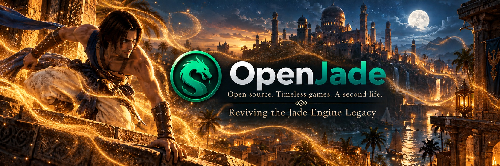

# OpenJade

  

**An open-source reimplementation of Ubisoft's Jade Engine, with the long-term goal of supporting multiple games.**

## About the project

OpenJade is an independent research and reverse-engineering project aimed at recreating the functionality of Ubisoft's Jade Engine from scratch, without access to the original engine source code.

The project currently focuses on Prince of Persia: The Sands of Time (2003) as its initial reference, using the PC GOG edition for research and validation.

However, OpenJade is not intended to remain limited to a single game. Its long-term vision is to develop a reusable engine architecture capable of supporting other Jade Engine titles, including the rest of the Prince of Persia trilogy and Beyond Good & Evil.

The project emphasizes documented reverse engineering, independently implemented systems, and the preservation of classic games through modern, open-source technology.

Windows remains the primary development platform. Initial native Rust/Vulkan validation has also been completed on Linux and macOS, although broader cross-platform support remains experimental.

Game resources must come from the user's own local installation and are not distributed here.

> [!NOTE]
> Generative AI assists with research and implementation under human supervision.
> Findings and generated code are subject to testing and verification.

## Game compatibility

| Game | Status |
| --- | --- |
| Prince of Persia: The Sands of Time (2003) | Active development |
| Prince of Persia: Warrior Within (2004) | Planned |
| Prince of Persia: The Two Thrones (2005) | Planned |
| Beyond Good & Evil (2003) | Long-term objective |

Each game may require additional research into engine versions, proprietary resources and game-specific systems.

**No game is currently playable through OpenJade.** Planned titles represent development goals, not existing compatibility or guaranteed future support.

## Current status

**An experimental native Rust/Vulkan menu prototype has been validated on Windows, Linux and macOS. The game is not playable.**

The current implementation focuses on reconstructing the main menu and its surrounding 3D environment from Prince of Persia: The Sands of Time.

The Rust/Vulkan viewer combines decoded 3D menu scenery with an interactive main
menu:
- Selecting Start New Game hides the interface and plays a nine-second
Camera02 transition toward the balcony, where the camera stops.
- Transparent scene effects are re-sorted as the camera moves.
- Escape returns to the main menu.

There is no controllable Prince, cutscene playback or level loading.

The scenery includes 50 decoded objects, textures, depth testing, three fog panels
and multi-pass light-fixture materials:
- Two dynamic fog emitters now add moving transparent mist alongside the existing panels.
- Supported fog and flame-texture offsets
animate in real time. The two suspended flames also deform using their decoded vertex animations.
- Seven palms, three additional plants and the hanging vine move using their decoded vertex deformation. Three mesh birds follow their waypoint loops and flap their wings. Two bird particle emitters and two fly swarms also animate in the menu. Drifting points of light come from a separate pollen emitter.
- Eight splash emitters animate alongside the two falling-rain emitters. The rain uses decoded parameters and verified particle geometry, colors and blending; timing remains under comparison.
- A measured scene-blur effect softens the 3D background while keeping the menu interface sharp.
- Scene textures retain their decoded dimensions; selected textures now use verified native mipmaps, including the sword. Filtering and generated mipmaps remain available for other textures.
- Lighting, transparency ordering and visual fidelity remain under investigation; this is not a faithful recreation yet.
- The sky and moon are now included; some small effects remain absent.
- Named scene lights are not yet reproduced as runtime lights; recorded vertex colors provide
part of the current appearance. The animated Prince, sword, articulated support and dagger can now be displayed on the balcony, with initial placement derived from the original collision geometry. His vertex lighting updates with animation; the prepared menu uses original scene data for its ambient color and three named lights, and a generated directional contribution follows the camera during the balcony transition. Native startup timing, remaining secondary motion, complete material fidelity and gameplay remain unfinished.

The detailed menu screens now run in the native viewer alongside the 3D scenery:
- Gamma, texture filtering, window resolution and V-Sync can be changed there,
with changes applied only after Back and confirmation, plus OpenJade-owned persistence.
- Profile selection and keyboard-binding editing are available; they do not load
original saves or control a playable character.

Audio/gameplay and unsupported graphics options are visibly disabled.

Python is used for offline preparation and research, not required alongside a prepared native menu.

## Prototype preview

The native prototype displays the main menu and its 3D background in one window,
with mouse/keyboard navigation, profile creation/selection, Controls, Game, Graphics Effects/Advanced, Sound and confirmation screens.

Original credits remain an explicit notice and Load Game is unavailable.

Text and widgets are composed in Rust using locally prepared MFT/DDS resources. The logo and cursor retain their original image dimensions, and text selects among twelve bitmap font variants as the window grows; the interface uses linear filtering. The cursor now combines its original base and glowing overlay with animation read from the menu resources.

Captures and generated asset bundles remain local and are not included in the
repository.

See the [native prototype workflow](README-dev.md#native-menu-workflow) and the [separate Python simulation](README-dev.md#optional-python-menu-simulation).

## Implemented capabilities

### Jade Engine research and foundations

| Area | Available today | Main limit |
| --- | --- | --- |
| Archives | Tested BF/BIG extraction and recognized POP-LZO decoding | Not a universal archive decoder |
| Resources | MGM structure/materials, menu links, DDS and MFT previews | Selected layouts; font styling remains experimental |

### Prince of Persia: The Sands of Time

| Area | Available today | Main limit |
| --- | --- | --- |
| Python menu simulation | Retained as a research/reference tool | No gameplay and optional legacy gamma bridge |
| Native menu | Interactive 3D menu with navigation, profiles, display settings and local persistence | No playable game, original save loading or functional audio
| Scene rendering | Reconstructed 3D environment with textures, materials, fog, transparency and selected postprocessing effects | Original lighting and overall visual fidelity remain incomplete
| Animation and effects | Animated vegetation, curtains, birds, rain, particles, flames and other menu effects | Timing, activation and some visual behaviors remain under investigation
| Camera02 | Reconstructed nine-second camera transition triggered by Start New Game | No gameplay, cutscene or level loading follows |
| Prince preview | Original-resource skeletal animation, equipment and animated-normal lighting; prepared balcony integration | Experimental: native timing, general scene lighting, remaining secondary controllers and gameplay are incomplete |

### Testing and platform validation

| Area | Available today | Main limit |
| --- | --- | --- |
| Validation | Synthetic tests, Vulkan validation and local visual checks | Windows/AMD primary. Initial Linux/AMD RADV and macOS/Apple Silicon KosmicKrisp validation successful (Rust engine only) |

## Development approach

OpenJade combines reverse-engineering research with the gradual development of a native engine.

The project currently relies on two complementary components:

- **Research tools:** Python, PowerShell and supporting utilities for archive extraction, proprietary format analysis, resource preparation and validation.
- **Native engine:** A Rust-based implementation using Vulkan for rendering, progressively reconstructing the behavior of the original engine.

While Prince of Persia: The Sands of Time provides the initial reference, the long-term architectural goal is to distinguish reusable engine functionality from game-specific behavior.

This approach is intended to facilitate future research and compatibility work across different Jade Engine titles.

## Roadmap

Development is organized around progressive milestones rather than fixed release dates.

### Phase 1 - Sands of Time foundation (current)

1. Improve scene fidelity: lighting, fog, filtering and transparency ordering.
2. Connect remaining menu settings to implemented game systems and refine interface fidelity.
3. Extend animation and scene/object systems beyond the baked camera transition.
4. Investigate collision, player control, cutscenes, audio and gameplay incrementally.

### Phase 2 - Core engine development (planned)

1. Expand reusable engine systems beyond the initial menu prototype.
2. Investigate scene management, object behavior and gameplay interactions.
3. Progress toward a functional implementation of Prince of Persia: The Sands of Time.
4. Continue investigating differences between original engine behavior and the independent implementation.

### Phase 3 - Extended game compatibility (long-term)

1. Investigate engine and resource differences across the Prince of Persia trilogy.
2. Explore support for Prince of Persia: Warrior Within and The Two Thrones.
3. Research Beyond Good & Evil and identify its game-specific requirements.
4. Extend the engine architecture where necessary to accommodate additional titles.

Future compatibility priorities may evolve based on research findings, technical feasibility and available contributions.

## Cross-platform support

Development remains primarily focused on Windows.

Initial native cross-platform validation was successfully performed on **2026-11-14**, covering the Rust engine on Linux and macOS.

### Linux (x86_64)

Testing was performed on Manjaro Linux with an AMD Radeon RX 9070 XT using Mesa RADV.

The Rust workspace built successfully, and Vulkan rendering was verified with both the menu and actor scenes. All 67 executed unit tests passed, with no Vulkan validation errors reported.

### macOS - Apple Silicon (ARM64)

Testing was performed on macOS 27.2.1 with an Apple M3 Pro, using the [KosmicKrisp](https://docs.mesa3d.org/drivers/kosmickrisp.html) Vulkan driver (Vulkan SDK 1.4.363.1).

The Rust workspace built successfully without macOS-specific source modifications. All 67 executed unit tests passed, and Vulkan rendering was verified with TSoT menu and a separate Prince scene.

Three runtime tests were completed successfully, with no Vulkan validation errors reported.

### Scope and limitations

Testing on Linux and macOS was limited to the Rust engine.

The project's PowerShell tooling currently targets **PowerShell 5.1**, which is Windows-only. Although **PowerShell 7** is available on Linux and macOS, compatibility with these platforms has not been tested or validated. The project's Python tools were also not tested or executed on either platform.

These results apply strictly to the engine's implementation and features available at the time of testing. They do not guarantee compatibility with future development or changes to the engine.

Linux and macOS support remain experimental. Validation has been limited to the specific operating systems, hardware, and Vulkan drivers described above. Broader cross-platform support remains a long-term objective as the engine matures.

There is no completion date or reliable overall completion percentage.
See [milestones and validation criteria](README-dev.md#roadmap-and-milestones).

## Getting started

Development remains primarily focused on Windows. The native Rust/Vulkan engine has also undergone initial validation on Linux and macOS, as described above.

The native viewer requires platform-specific Rust/Vulkan dependencies and locally prepared scene/menu bundles. Research workflows currently use the documented Windows PowerShell 5.1 and Python environment.

Ghidra supports optional static analysis and is not required to launch a prepared preview.

Start with the [developer setup guide](README-dev.md#first-time-setup), then choose the [native menu workflow](README-dev.md#native-menu-workflow) or the [optional Python menu simulation](README-dev.md#optional-python-menu-simulation).

A fresh checkout contains neither original game resources nor generated bundles.

## Documentation

- [Developer guide](README-dev.md): setup, commands, tests, milestones and architecture.
- [Engine guide](engine/README.md): native engine architecture, platform prerequisites, building, testing and viewer usage.
- [Format notes](docs/formats): observed layouts and local interchange formats.
- [Research observations](docs/observations): dated evidence and experiments.
- [Project decisions](docs/decisions) and [external research provenance](references).

## Contributing

OpenJade is an independent hobby project, and contributions are welcome.

Contributions may include reverse-engineering research, format documentation, testing, implementation improvements and technical feedback.

Research findings should ideally be reproducible, with verified observations clearly distinguished from assumptions or unresolved hypotheses.

There is no guaranteed completion date or release schedule.

## License & Legal Disclaimer

OpenJade is an independent research and open-source reverse-engineering project. It is not affiliated with, endorsed by, associated, or sponsored with Ubisoft.

All trademarks and product names belong to their respective owners. Prince of Persia, Beyond Good & Evil, the Jade Engine, and all associated trademarks and game assets remain the property of their respective rights holders.

No original game data, copyrighted assets or proprietary engine source code are distributed with this repository. Users must provide resources from their own legally obtained game installations.

OpenJade is licensed under the GNU General Public License v3.0 or later
(GPL-3.0-or-later). See [LICENSE](LICENSE) for details.
